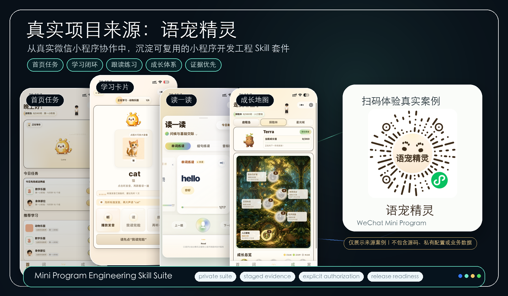

<p align="center">
  
</p>

# Mini Program Engineering Skill Suite

<p align="center">
  
  
  
  
  
  
  
  
  
  
</p>

<p align="center">
  <a href="./README.md">中文</a> ·
  <a href="./README.zh-Hant.md">繁體中文</a> ·
  <a href="./README.en.md">English</a> ·
  <a href="./README.ja.md">日本語</a> ·
  <a href="./README.th.md">ไทย</a> ·
  <a href="./README.id.md">Bahasa Indonesia</a>
</p>

**Mini Program Engineering Skill Suite** คือชุด Agent Skill สำหรับช่วยพัฒนา WeChat Mini Program ตั้งแต่เริ่มต้น รับช่วงต่อโปรเจกต์เดิม และเตรียมความพร้อมก่อนปล่อยใช้งานจริง โดยแยกงานออกเป็นขั้นตอนที่ตรวจสอบได้: ต้องทำอะไร ทำอย่างไร ทำถึงขั้นไหน และมีหลักฐานอะไรยืนยัน

ชื่อภาษาจีน: **小程序开发工程技能套件**.

รุ่น 3.6.0 เพิ่มความชัดเจนสามเรื่อง: แยกข้อมูลที่อัปเดตช้าออกจากความผิดปกติจริง ตรวจตัวตน สภาพแวดล้อมและขอบเขตทั้งหมดควบคู่กับสถานะ และให้ภาพตัวอย่างก่อนลบ การยืนยันและการทำงานจริงตรงกัน คงขั้นตอนเดิมและข้อมูลที่ผู้ใช้กรอกเมื่อเกิดข้อผิดพลาด ตรวจผลที่ยังไม่ทราบก่อนลองใหม่ และลดการทำซ้ำหรือทดสอบโดยไม่มีการเปลี่ยนแปลง

> หมายเหตุ: ชั้นข้อเท็จจริงของแพลตฟอร์มครอบคลุม WeChat, Alipay และ Douyin แล้ว (ความสามารถในการตรวจจับระบุอย่างตรงไปตรงมา ดู "ความสดของกฎแพลตฟอร์ม" ด้านล่าง) สำหรับ LINE MINI App, Telegram Mini Apps หรือระบบอื่น ๆ สามารถนำแนวคิดไปปรับใช้ได้ แต่ยังต้องปรับกฎแพลตฟอร์มแยกต่างหาก

---

## จุดเด่นหลัก

- **ชั้นข้อเท็จจริง 3 แพลตฟอร์ม**: แหล่งความจริงเดียวของกฎแพลตฟอร์ม WeChat / Alipay / Douyin โดย capability doctor ตรวจจับเทคโนโลยีและแพลตฟอร์มเป้าหมายของโปรเจกต์โดยอัตโนมัติ ความสามารถตรวจจับระบุอย่างตรงไปตรงมา — WeChat รองรับการเฝ้าระวังลายนิ้วมือแบบ deterministic ส่วน Alipay / Douyin อาศัยการเช็คเอกสารทางการขณะรันและการรายงานจากผู้ใช้ ไม่แอบอ้างว่าตรวจจับอัตโนมัติได้ (ดู [ความสดของกฎแพลตฟอร์ม](#ความสดของกฎแพลตฟอร์ม))
- **ไปป์ไลน์ความสดของกฎแพลตฟอร์ม**: ฝั่ง execution ตรวจสอบเอกสารทางการฉบับปัจจุบัน และฝั่งเนื้อหาตรวจจับ drift ทุกสัปดาห์ เฉพาะการอัปเดต `facts.md` ที่ผ่านการตรวจสอบอย่างสอดคล้องเท่านั้นที่จะสร้าง PR และรวมอัตโนมัติหลัง CI ผ่าน ส่วนผลลัพธ์อื่นคงอยู่ใน issue (ดู [ความสดของกฎแพลตฟอร์ม](#ความสดของกฎแพลตฟอร์ม))
- **Agent session จริงและการตรวจอาร์ติแฟกต์**: tier1 ตรวจแบบ static ในเครื่อง ส่วน tier2/3 และการตัดสินอิสระใช้ session จริง รุ่นที่เปลี่ยนพฤติกรรมต้องผ่าน tier4 แบบเปรียบเทียบโครงการไม่ระบุตัวตนด้วย 3.6.0 ผ่านการประเมินเป็นชั้นด้วย ZCode / GLM โดยการเปรียบเทียบผลงานและการตัดสินคุณภาพอิสระสุดท้ายใช้ GLM-5.3-Flash ดูโมเดล ขอบเขตและหลักฐานใน [EVALUATIONS.md](EVALUATIONS.md)
- **ตรวจขอบเขตการใช้งานประจำวันครบขึ้น**: ช่วย Agent ตรวจการรีเฟรชเมื่อกลับหน้า การปิดและเปิด dialog การพิมพ์ต่อระหว่างบันทึกอัตโนมัติ และการกู้คืนเมื่อ cloud ล้มเหลว เพื่อไม่ให้สถานะเก่ารบกวนงานใหม่ ต้องตรวจผลในโปรเจกต์เป้าหมาย
- **คุณภาพมาก่อนและเห็นความคืบหน้า**: เดินหน้าขั้นตอนหลัก ส่งมอบผลที่ตรวจดูได้ ทดสอบซ้ำตามการเปลี่ยนแปลง ความล้มเหลวจริงหรือหลักฐานที่ขาด และส่งต่องานที่ผู้ใช้เลือกทำเองอย่างทันเวลา
- **วินัยวิศวกรรมที่ให้หลักฐานมาก่อน**: ทุกสถานะต้องมีหลักฐานตรงกันรองรับ ไม่งั้นระบุ unknown อย่างตรงไปตรงมา วินัยนี้แยกเป็นชั้นพื้นฐาน `foundation/` ที่ไม่ผูกโดเมน ชุด engineering ของ Agent ใดก็นำกลับไปใช้ได้ (ดู [หลักการออกแบบ](#หลักการออกแบบ))
- **ประเมินเป็นชั้น + ลงนามอิสระ**: tier1 โครงสร้าง / tier2 routing / tier3 พฤติกรรม / tier4 ตรวจว่าอาร์ติแฟกต์จากโปรเจกต์สังเคราะห์แบบไม่ระบุตัวตนไม่ถดถอย ตัดสินอิสระระหว่าง with-skill กับ baseline และชุด held-out ที่ตรึงจนถึงวันรีลีส — ต้องผ่านเกตครบจึงรีลีส (ดู [EVALUATIONS.md](EVALUATIONS.md))
- **ธรรมาภิบาลรีลีสระดับ supply chain**: SHA256 + dual manifest + fail-closed packaging + ตรวจซ้ำฝั่งผู้รับ + สแกนข้อมูลอ่อนไหวเป็นศูนย์ ความสม่ำเสมอโครงสร้าง README 6 ภาษามีสคริปต์เฝ้าไว้ (ดู [ความสมบูรณ์ของ package](#ความสมบูรณ์ของ-package))

---

## เข้าใจ Skill นี้ใน 32 วินาที

ถ้าต้องการดูภาพรวมว่าสิ่งนี้แก้ปัญหาอะไร มาจากโปรเจกต์จริงแบบไหน และควรใช้อย่างไร ให้เริ่มจาก[วิดีโออธิบาย 32 วินาที](https://raw.githubusercontent.com/NocodeMrLi/mini-program-engineering-skill-suite/main/assets/readme-promo.mp4)นี้

https://github.com/user-attachments/assets/d382951e-5175-48be-b0c0-44ba210706f1

<sub>วิดีโอนี้ใช้เพื่ออธิบายตำแหน่งของชุด Skill ที่มา และขอบเขตการใช้งานเท่านั้น</sub>

---

## สถานะโปรเจกต์

repository นี้เป็นหน้าโครงการสาธารณะของชุด Skill และเผยแพร่ภายใต้ **MIT License** คุณสามารถดู ใช้ แก้ไข และแจกจ่ายต่อได้ ดูรายละเอียดได้ที่ [LICENSE](LICENSE)

---

## แก้ปัญหาอะไร

สำหรับคนที่ไม่เคยทำ mini program มาก่อน ความยากไม่ได้อยู่แค่การเขียนโค้ด แต่คือการรู้ว่าควรยืนยันอะไรก่อน ตัดสินใจอะไรจะกระทบขั้นตอนถัดไป ควรหยุดเพื่อตรวจสอบเมื่อไร และก่อนปล่อยจริงมีอะไรที่ห้ามข้ามด้วยความรู้สึก

ปัญหาที่พบบ่อย:

- ติดตั้ง environment แล้ว error หรือ config ไม่ตรงกัน；
- หลังปล่อยจึงพบว่าสิทธิ์หรือ privacy policy ยังไม่ครบ；
- UI เพี้ยนบนอุปกรณ์จริง แม้ดูดีใน simulator；
- สับสนระหว่าง build, submission, acceptance และ release；
- เผลอ push หรือปล่อยสิ่งที่ยังไม่ได้ยืนยัน ต้อง rollback ด่วน

ชุดนี้ช่วยให้ Agent เริ่มจากการเข้าใจเป้าหมายและขอบเขต สร้าง specification และแผนวิศวกรรม จากนั้นทำทีละขั้น ตรวจสอบเป็นชั้น ๆ และจัดการความเสี่ยงก่อน release มันไม่แทนที่การตัดสินใจทางธุรกิจหรือผลิตภัณฑ์ แต่ช่วยให้ผู้ใช้รู้ว่า “ขั้นต่อไปคืออะไร ทำไปทำไม และต้องมีหลักฐานแค่ไหน”

---

## ที่มาจากโปรเจกต์จริง: WordPet

Skill นี้ไม่ได้เขียนจาก tutorial เชิงนามธรรม แต่สกัดมาจากการทำงานระยะยาวบน WeChat Mini Program จริงชื่อ **WordPet** สิ่งที่เผยแพร่ใน repository นี้คือวิธีการที่นำกลับมาใช้ซ้ำได้: การแยกงานผลิตภัณฑ์ การลงมือทำ การตรวจสอบ การยอมรับงาน ความพร้อมก่อน release และการจัดการหลักฐาน

<p align="center">
  
</p>

<sub>WordPet แสดงเป็นกรณีต้นทางเท่านั้น repository นี้ไม่รวม source code, AppID, cloud resources, private configuration, business data, review status หรือ internal development records ของ mini program ดังกล่าว QR code มีไว้เพื่อทดลองกรณีจริงเท่านั้น และผลการสแกนขึ้นอยู่กับสถานะปัจจุบันของแพลตฟอร์ม WeChat</sub>

---

## ช่วยให้ Agent ทำอะไรได้

- **รับช่วงต่อโปรเจกต์**: อ่านสถานะปัจจุบันก่อนแก้ไข เพื่อไม่ทำลายงานที่เสร็จแล้ว；
- **ทำ requirement ให้ชัด**: เปลี่ยนไอเดียกว้าง ๆ เป็น specification ที่ตรวจรับได้；
- **บันทึก decision**: เชื่อมการตัดสินใจเข้ากับ architecture, data, API, permission และ fallback；
- **แก้โค้ดอย่างปลอดภัย**: ทำทีละส่วนเล็ก ๆ และ rollback ได้；
- **ตรวจสอบเป็นชั้น**: แยก UI preview, user confirmation, integration, device check และ final acceptance；
- **debug ด้วยหลักฐาน**: ใช้ evidence แทนการเดา；
- **รายงานตรงไปตรงมา**: บอกเฉพาะสิ่งที่ตรวจสอบแล้ว

---

## ความสามารถหลัก

| ส่วน | หน้าที่ |
| --- | --- |
| Project intake | อ่านโปรเจกต์แบบ read-only เพื่อทำ fact map, risk map และ change boundary |
| Product specification | MVP scope, user flow, state matrix และ acceptance criteria |
| Architecture | module, data, API, permission และ failure strategy |
| Platform adaptation | เครื่องมือ WeChat Mini Program, privacy, permission และ platform evidence |
| Implementation | scoped changes, tests และการปกป้องงานเดิม |
| UI and device adaptation | preview-first, responsive และตรวจหลายอุปกรณ์ |
| Debugging | reproduction, competing hypotheses, root cause และ regression coverage |
| Verification | static, unit, integration, simulator, device, cloud และ release evidence |
| Release readiness | version, build, security, privacy, rollback, upload / review / release governance |

---

## หลักการออกแบบ

- ตรวจข้อเท็จจริงก่อนลงมือ: อย่าแก้โปรเจกต์เดิมก่อนรู้สถานะจริง
- สถานะต้องมีหลักฐาน: รายงานเฉพาะสิ่งที่ตรวจสอบแล้ว
- แยกแต่ละขั้นให้ชัด: preview, implementation, build, upload, review, acceptance และ release ไม่ใช่สิ่งเดียวกัน
- external action ต้องอนุญาตแยก: cloud change, upload, submit review และ publish ต้องขออนุญาตทีละรายการ
- แยกข้อมูลส่วนตัว: public package และ README assets ต้องผ่าน sensitive-content scan

---

## ความสดของกฎแพลตฟอร์ม

กฎของแพลตฟอร์มเปลี่ยนแปลงตลอดเวลา กฎที่เขียนตายใน skill ย่อมล้าสมัย ชุดนี้ใช้หลัก "ปรับสดตอนทำงาน วิวัฒน์แบบควบคุม":

- **ตรวจหลักฐานทางการก่อนทำงาน**: การ upload ส่งทวนสอบ เผยแพร่ แจ้ง privacy และโควตา ต้องตรวจวันที่ แหล่งที่มาและขอบเขตของข้อมูล แล้วเช็คเอกสารทางการปัจจุบันหากข้อมูลเก่าหรือมีความเสี่ยงสูง ถ้ายืนยันไม่ได้ให้คง unknown และหยุดงานที่อาศัยข้อมูลนั้น กระบวนการนี้ไม่รับประกันความถูกต้องของรุ่นเก่า จึงควรอัปเดตชุดในเครื่องด้วย
- **เนื้อหาวิวัฒน์แบบควบคุม**: ผู้ดูแลตรวจจับการเปลี่ยนแปลงด้วยเครื่องมือเทียบลายนิ้วมือของหน้าเอกสารทางการ ผ่านการตรวจสอบอิสระหลายรอบก่อนอัปเดต คุณแจ้งการเปลี่ยนแปลงที่พบได้ผ่านแบบฟอร์ม **Platform rule drift** ใน Issues
- **อยากใช้เวอร์ชันล่าสุด**: ดาวน์โหลดจาก Releases แล้ว `install.sh --force` — ไม่มีการอัปเดตเงียบโดยไม่แจ้ง

ข้อเท็จจริงและแผนที่กฎอยู่ใน `platforms/` ปัจจุบันครอบคลุม WeChat, Alipay และ Douyin — WeChat รองรับการเฝ้าระวังลายนิ้วมือแบบ deterministic พร้อมตรวจจับ drift อัตโนมัติรายสัปดาห์; เอกสารทางการของ Alipay และ Douyin เป็น client-rendered จึงสังเกตการเปลี่ยนแปลงเนื้อหาด้วยลายนิ้วมือไม่ได้ จึงระบุอย่างตรงไปตรงมาว่า `manual-only` — ความสดพึ่งการเช็คเอกสารทางการขณะรันและการรายงานจากผู้ใช้ ไม่แอบอ้างว่าตรวจจับอัตโนมัติได้ แพลตฟอร์มที่ยังไม่รวมจะเช็คเอกสารทางการเสมอและคงสถานะ `unknown` ไม่เดา

---

## วิธีใช้

clone repository นี้ไปยัง directory ของ Agent app ที่รองรับ `SKILL.md` หรือ project rules ถ้าไม่อยากติดตั้งเอง ให้ส่งข้อความนี้ให้ Agent ที่คุณใช้อยู่:

```text
https://github.com/NocodeMrLi/mini-program-engineering-skill-suite.git ช่วยติดตั้ง skill นี้ให้ฉัน
```

สำหรับ Codex App / Codex local skills:

```bash
git clone https://github.com/NocodeMrLi/mini-program-engineering-skill-suite.git \
  ~/.codex/skills/mini-program-engineering-suite
```

สำหรับ universal Agent Skills runners:

```bash
git clone https://github.com/NocodeMrLi/mini-program-engineering-skill-suite.git \
  ~/.agents/skills/mini-program-engineering-suite
```

ถ้าใช้ installer, `--target codex` จะติดตั้งไปที่ `~/.codex/skills` และ `--target agents` จะติดตั้งไปที่ `~/.agents/skills`

หลังติดตั้ง ให้เปิด session ใหม่แล้วเรียกใช้:

```text
/mini-program-engineering-suite ฉันอยากทำ WeChat Mini Program จาก 0 ถึง 1 ช่วยเริ่มจาก product scope และ development steps
```

### อัปเดตชุดที่ติดตั้งแล้ว

การ merge repository หรือเผยแพร่ tag ไม่ได้แทนที่ไฟล์ skill ในเครื่อง ดาวน์โหลดและตรวจ package จาก Releases แล้วรันใน directory ที่แตกไฟล์:

```bash
cd mini-program-engineering-suite-v3.6.0
bash install.sh --target auto --force
```

ตัวติดตั้งย้าย directory เดิมไปเป็น backup ที่มีเวลาอยู่ข้าง directory เดิมก่อน ใช้ path backup ที่แสดงในการติดตั้งครั้งนี้เพื่อย้ายออกจาก directory ที่ runner ใช้ค้นหา skill ตรวจ VERSION ของทุกที่ที่ติดตั้ง และอัปเดตสำเนาหรือทางเข้าของส่วนย่อยที่ติดตั้งแยกไว้เพื่อไม่ให้หลายรุ่นปนกัน อ่านเนื้อหาใหม่ได้ในเทิร์นถัดไปหรือ session ใหม่

---

## สิ่งที่ไม่ทำ

ชุดนี้ไม่ติดตั้ง dependencies อัตโนมัติ ไม่สร้าง cloud resources ไม่ upload package ไม่ submit review ไม่ publish release และไม่เปลี่ยน online state เอง ทุก external write action ต้องได้รับอนุญาตแยกต่างหาก

---

## การตรวจสอบ

ก่อนถือว่า release พร้อมใช้งาน จะมี structural validation, sensitive-content scan, deterministic public-package export, manifest verification, routing evaluation, behavior evaluation และ independent final review

ตรวจข้อมูลแพลตฟอร์มตามวันที่ แหล่งที่มาและขอบเขต หากยืนยันไม่ได้ให้คง unknown และหยุดงานที่เกี่ยวข้อง แยกการรองรับ engine ออกจากขอบเขตที่ทดสอบจริงใน [EVALUATIONS.md](EVALUATIONS.md)

ชั้นการประเมิน ขอบเขตของหลักฐาน และสรุปผลสาธารณะรายเวอร์ชัน อยู่ใน [EVALUATIONS.md](EVALUATIONS.md)

ตรวจในเครื่อง:

```bash
python3 -m unittest discover -s tests -q
python3 scripts/validate_suite.py .
python3 scripts/check_i18n_readme_structure.py .
python3 scripts/scan_sensitive_content.py . --format json
```

---

## ความสมบูรณ์ของ package

แนะนำให้ใช้ package ตาม version จาก [GitHub Releases](https://github.com/NocodeMrLi/mini-program-engineering-skill-suite/releases) แต่ละ Release จะมี archive, `package-manifest.json`, `gate-summary.json` และ `SHA256SUMS` ที่ครอบคลุมทั้งสามไฟล์ เปิดใช้ Immutable Releases แล้ว: แนบ asset ทั้งหมดในช่วง draft และหลังเผยแพร่จะเปลี่ยน tag หรือ asset ไม่ได้ โดยตรวจผล SemVer และ signed evaluation gate ได้จาก `gate-summary.json` บน Linux / GitHub Actions ใช้ `sha256sum -c SHA256SUMS`; บน macOS ใช้ `shasum -a 256 -c SHA256SUMS` จากนั้นแตกไฟล์และตรวจซ้ำด้วย `verify_public_package.py` ใน package

ตรวจ package ที่ได้รับ:

```bash
python3 <package-dir>/scripts/verify_public_package.py <package-dir>
```

ตัวอย่าง v3.6.0 (หลังดาวน์โหลดจาก Release):

```bash
tar -xzf mini-program-engineering-suite-v3.6.0.tar.gz
python3 mini-program-engineering-suite-v3.6.0/scripts/verify_public_package.py \
  mini-program-engineering-suite-v3.6.0
```

---

## เวอร์ชัน

รุ่น 3.6.0 เพิ่มความชัดเจนในการตรวจข้อมูลต่างเวลา การแยกสถานะออกจากตัวตน และการผูกขอบเขตที่ยืนยันก่อนลบเข้ากับการเขียนแบบอะตอมมิก โดยคงขั้นตอนเดิมและลดการยืนยัน อัปโหลด และทดสอบซ้ำที่ไม่จำเป็น ดูขอบเขตการประเมิน GLM และผลการเผยแพร่จริงที่ [EVALUATIONS.md](EVALUATIONS.md) และ Release。

เวอร์ชันปัจจุบัน: **3.6.0** [v3.6.0 เผยแพร่แล้วและดาวน์โหลดแพ็กเกจสาธารณะได้](https://github.com/NocodeMrLi/mini-program-engineering-skill-suite/releases/tag/v3.6.0) หน้านี้อธิบายความสามารถปัจจุบัน ดูประวัติรุ่นที่ [CHANGELOG.md](CHANGELOG.md) และขอบเขตการประเมินกับหลักฐานที่ [EVALUATIONS.md](EVALUATIONS.md)

การตรวจรุ่น v3.6.0 ผ่านการทดสอบแบบกำหนดแน่นอน 386/386 รายการ CI ของ commit สุดท้ายที่มีลายมือชื่อ 9/9 และสถานการณ์ด้านเทคนิคกับการทำงานร่วมกัน 12/12 การเปรียบเทียบสองกรณีรวมรายงานสุดท้าย 8 ฉบับได้คะแนนดีขึ้นเฉลี่ย 2.7375 โดยรุ่นใหม่มีข้อผิดพลาดร้ายแรงและการถดถอยของมิติสำคัญ 0 ผ่านการตัดสินคุณภาพอิสระสุดท้ายสองครั้งและตรวจลายมือชื่อ RSA แล้ว checksum ของไฟล์เผยแพร่ทั้ง 4 รายการและไฟล์สาธารณะ 129 ไฟล์ตรงกับการส่งออกจาก tag ทุกไบต์ การตรวจนี้ไม่แทนการตรวจรับบนอุปกรณ์จริง คลาวด์หรือธุรกรรมจริงในโครงการเป้าหมาย และไม่ได้วัดความเร็วการพัฒนาที่เพิ่มขึ้น

---

## สัญญาอนุญาต

License: **MIT License**.
